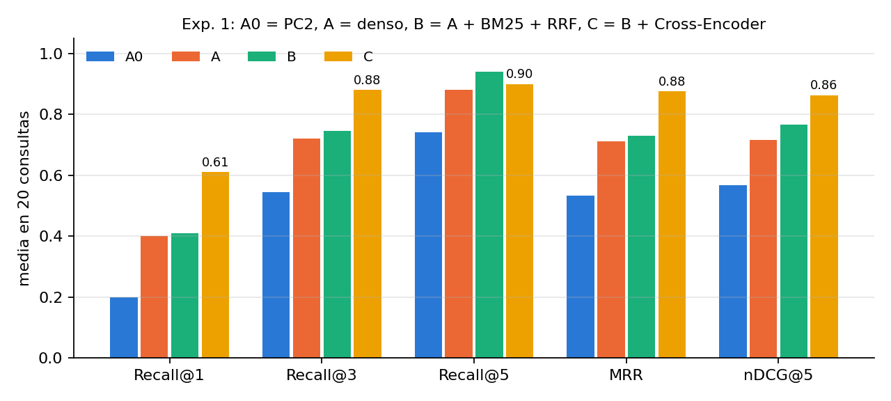
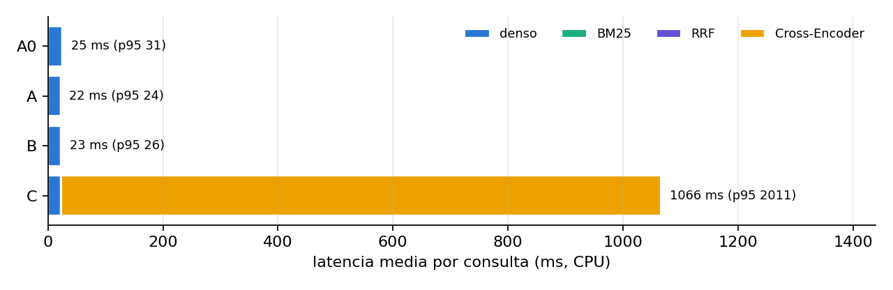
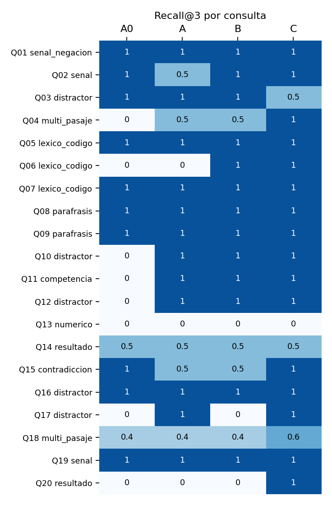
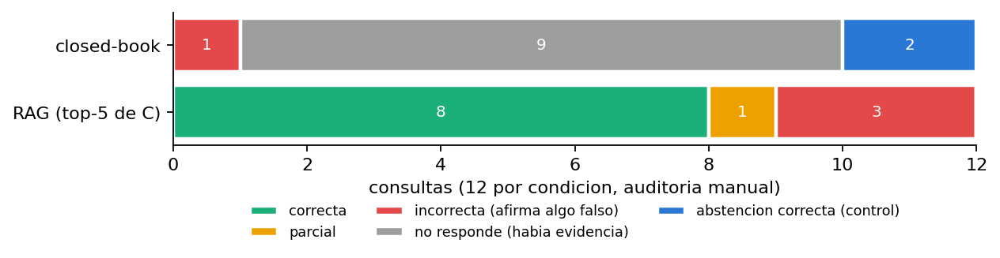

# Examen Parcial CC0F4 · Recuperación, RAG y contratos de herramientas

**CC0F4 · Tópicos de Ciencia de la Computación I · 2026-2 · Examen Parcial**
**Autores:** David Fernando Reeves Goñi y Luis Azaña Vega
**Tema (el mismo de la PC1 y la PC2):** Sistema multi-agente LLM para la detección de requisitos direccionados en bases de contrataciones del Estado usando registros OCDS.

La carpeta `EP/` es la versión evaluable del examen (equivale a la carpeta `parcial/` del enunciado). Reutiliza el código de la PC1 (`../src/`) y de la PC2 (`../pc2/src/`) sin borrar nada de esas entregas.

```text
consulta del auditor
  -> recuperación (denso e5 + FAISS | + BM25 + RRF | + Cross-Encoder)
  -> top-5 pasajes con su id
  -> Qwen2.5-1.5B (greedy) -> JSON {respuesta, citas, abstencion}
  -> auditoría de corrección, citas y faithfulness

ocid -> ocds.indicadores_proceso (contrato de entrada -> dominio -> contrato de salida)
     -> ToolResult / ToolError, reintento solo de fallos transitorios
```

**Commit de evaluación.** Los resultados de este README salen del commit `ff897db`. El orden de los commits muestra que el benchmark se fijó antes de correr los experimentos:

| Commit | Qué fija |
|---|---|
| `b623b36` | corpus, consultas, qrels y referencias congelados con SHA-256 (antes de cualquier experimento) |
| `f59e91d` | el hash deja de depender del fin de línea (los datos no cambian) |
| `664a03c` | experimento 1: código y resultados |
| `b549263` | prompt y código del experimento 2, **antes** de generar las respuestas |
| `784c4e8` | experimento 2: salidas y auditoría |
| `4726193` | experimento 3: herramienta, pruebas y resultados |
| `ff897db` | README de datos, figuras y demo |

---

## 1. Problema y continuidad con la PC1 y la PC2

Un requisito está **direccionado** cuando su redacción favorece a una marca o proveedor, por ejemplo exigiendo una marca sin admitir "o equivalente". El que revisa un proceso (un auditor o un postor) tiene que encontrar la evidencia dentro de muchos procesos parecidos y no puede confiar en una respuesta que no diga de dónde sale.

| Entrega | Qué hizo | Qué quedó pendiente |
|---|---|---|
| PC1 | Qwen2.5-0.5B clasifica el riesgo de **un** requerimiento OCDS en un JSON validado en 3 niveles | el modelo no busca evidencia; solo ve el texto que le damos |
| PC2 | recuperador denso (e5-small + FAISS) sobre 10 fichas OCDS, 5 necesidades | Recall@3 = 0,47; errores N5 (el chunk separa la buena pro del ítem que la identifica), N4 y N2 (la frase "o equivalente" se diluye en el embedding) |
| **EP** | corpus de 55 procesos, comparación A/B/C, RAG con citas, herramienta con contratos | ver limitaciones (sección 11) |

Correcciones a la PC2 que se aplican aquí:

- **Unidad de recuperación.** En vez de chunks de 180 palabras, cada unidad es un pasaje con el encabezado de su proceso (nomenclatura, objeto y entidad). Así cada unidad tiene la evidencia y lo que la identifica (error N5). La configuración de la PC2 se mantiene como referencia **A0**, para medir el cambio en lugar de suponerlo.
- **Señal léxica.** N2 mostró que el denso falla con frases cortas y códigos; por eso B agrega BM25.
- **Corpus y consultas.** 55 documentos y 20 consultas con qrels en lugar de 10 y 5, con distractores reales.

**Pregunta general:** sobre el mismo benchmark, ¿qué arquitectura de recuperación encuentra mejor la evidencia, cuánto cuesta, y entregar esa evidencia al LLM produce respuestas correctas y sustentadas?

## 2. Arquitectura y archivos

| Pieza | Archivo | De dónde viene |
|---|---|---|
| Corpus desde OCDS | `src/armar_corpus.py` | `passages_de` de la PC2 (`pc2/src/construir_corpus.py`) y `ficha_proceso` de la PC1 (`src/ocds.py`) |
| Benchmark y congelamiento | `src/benchmark.py`, `data/congelamiento.json` | nuevo |
| Métricas | `src/metricas.py` | Cuaderno 7: §2 `expand_to_passage_ranking`, §3 `recall_at_k`/`reciprocal_rank`/`dcg_at_k`/`ndcg_at_k`, §5.1 `paired_bootstrap_delta`, §6 `classify_retrieval_failure` |
| Recuperación A0/A/B/C | `src/recuperacion.py` | encoder, índice y chunker de la PC2 (`pc2/src/recuperador.py`); tokenizador y stopwords de BM25 copiados de `tokenize_bm25` (Cuaderno 7 §4, la misma lista del Cuaderno 5 §0); RRF del Cuaderno 5 §5 |
| Experimento 1 | `src/exp1_recuperacion.py` | protocolo A/B/C del Cuaderno 7 §5 |
| RAG | `src/rag.py`, `prompts/` | LLM de la PC1 (`src/llm.py`); parseo JSON de la PC1 (`src/validacion.py`, que sigue el Cuaderno 3 §9); `metricas_citas` adaptado de `citation_metrics` (Cuaderno 7 §7) |
| Experimento 2 | `src/exp2_rag.py` | closed-book vs RAG del Cuaderno 5 §10 y auditoría del Cuaderno 7 §9 |
| Herramienta | `src/herramienta.py`, `data/indice_procesos.jsonl` | Cuaderno 6: `ToolError`/`ToolResult`/`error_result` del §3 (mismos campos y taxonomía), inyección de fallos del §4, `Policy` del §5 |
| Experimento 3 y pruebas | `src/exp3_herramienta.py`, `tests/test_herramienta.py` | nuevo |
| Figuras y demo | `src/reporte.py`, `src/demo.py` | nuevo |

Modelos (todos con revisión fijada en `src/config_ep.py` o `../src/config.py`):

| Rol | Modelo | Revisión |
|---|---|---|
| Embeddings (A, B, C, A0) | `intfloat/multilingual-e5-small` | `614241f622f53c4eeff9890bdc4f31cfecc418b3` |
| Reranker (C) | `cross-encoder/mmarco-mMiniLMv2-L12-H384-v1` | `1427fd652930e4ba29e8149678df786c240d8825` |
| Generador (exp. 2) | `Qwen/Qwen2.5-1.5B-Instruct` | `989aa7980e4cf806f80c7fef2b1adb7bc71aa306` |

**Arquitectura del generador** (del `config.json` de esa revisión). `Qwen2ForCausalLM`, un Transformer decoder-only con máscara causal (Cuaderno 1 §4 y §6; Lectura 2 §3). Tiene 28 bloques y `hidden_size` 1536. Usa 12 cabezas de consulta y 2 de clave/valor (GQA, Cuaderno 2 §12), con `head_dim` 1536 / 12 = 128. La posición se codifica con RoPE (`rope_theta` 1 000 000, Cuaderno 1 §3.1). El vocabulario es de 151 936 tokens y la ventana de 32 768 posiciones (Cuaderno 2 §9). Cada cabeza de clave/valor la comparten 6 cabezas de consulta, así que el KV cache ocupa 6 veces menos que con MHA.

Todo corre en CPU (AMD Ryzen 7 7735HS, 8 hilos, `float32`), con Python 3.10.11, torch 2.9.0, transformers 4.57.1, sentence-transformers 5.1.2, faiss-cpu 1.15.1, rank-bm25 0.2.2, pydantic 2.12.3 y pytest 8.4.2.

## 3. Cómo ejecutar

Desde la raíz del repositorio, con el entorno de la PC1/PC2 (`pip install -r requirements.txt`):

```bash
python EP/src/benchmark.py
```

Valida corpus, consultas, qrels y referencias, y muestra un resumen.

```bash
python EP/src/exp1_recuperacion.py
```

Experimento 1 (~1 min). La primera vez descarga e5-small y el Cross-Encoder; luego corre con `HF_HUB_OFFLINE=1`.

```bash
python EP/src/exp2_rag.py
```

Experimento 2. Si `results/exp2/cache_llm.jsonl` está presente, lee las respuestas de la caché; si no, genera las 24 respuestas con Qwen2.5-1.5B (~12 min en CPU).

```bash
python EP/src/exp2_rag.py resumir
```

Junta la salida automática con la auditoría manual y escribe `results/exp2/resumen.csv`.

```bash
python EP/src/exp3_herramienta.py
```

Experimento 3 (segundos).

```bash
python -m pytest EP/tests -q
```

Pruebas de la herramienta (22 pruebas).

```bash
python EP/src/reporte.py
```

Figuras en `results/figs/`.

```bash
python EP/src/demo.py Q15
```

Demo: consulta, evidencia, respuesta con citas, métrica y herramienta. Con `--en-vivo` recupera con los modelos en vez de leer los rankings guardados.

```bash
python EP/slides/construir_slides.py
```

Diapositivas (`slides/Examen_Parcial_CC0F4.pptx` y `.pdf`; el PDF se exporta con PowerPoint).

`armar_corpus.py` y `armar_indice.py` solo hacen falta si se quiere regenerar los datos desde los CSV OCDS; el corpus y el índice ya están versionados.

## 4. Corpus, consultas y qrels

El detalle está en [`data/README.md`](data/README.md). En resumen:

- **55 documentos reales**, uno por proceso del SEACE (identificado por su `ocid`), y **426 pasajes** trazables: convocatoria, ítems, cronograma, documentos, postores, resultado y contrato. E01-E10 son los documentos de la PC2 y E11-E55 el resto de los casos del benchmark v2 de la PC1.
- El texto de los requerimientos y los nombres se copian tal cual de OCDS; las frases que los rodean son de una plantilla fija. No hay texto generado por un modelo.
- **22 consultas**: 20 con qrels y 2 controles sin evidencia (Q21 sanciones, Q22 plazo de entrega). 11 son difíciles: distractores reales (cuatro compras de Office, dos de Adobe, dos procesos con Oracle, dos del mismo hospital), códigos exactos, paráfrasis, una consulta numérica, una contradicción y dos multi-pasaje.
- Los qrels se anotaron leyendo los pasajes y se congelaron (commit `b623b36`) antes de correr cualquier sistema. Los scripts verifican los hashes y se detienen si algo cambió.

## 5. Matriz de trazabilidad (Semanas 1-7)

Los recursos se citan con su ruta en el repositorio del curso (`SemanaN/...`) y la sección (§) del cuaderno o la lectura. Cuando hay código, se nombra la función del cuaderno para poder buscarla. "Dónde se aplica" apunta a archivos y secciones de este EP; `../` es la raíz del repositorio (PC1).

| Semana | Recurso revisado | Concepto | Dónde se aplica | Evidencia | Limitación o conclusión propia |
|---|---|---|---|---|---|
| 1 | `Semana1/Cuaderno1-CC-0F4.ipynb` §2 (texto → tokens → ids → embeddings), §4 (`make_causal_mask`, `scaled_dot_product_attention`), §5 (`MultiHeadAttention`), §6 (`TransformerBlock` decoder-only). `Semana1/Lectura2-CC-0F4.md` (Vaswani et al., 2017) §2 atención y §3 causalidad. `Semana1/Lectura1-CC-0F4.md` "Encoder, decoder y modelos autoregresivos" | tokens, Q/K/V, atención, máscara causal, encoder-only vs decoder-only | `src/recuperacion.py`: `Sistema` usa e5-small como bi-encoder (consulta y pasaje se codifican por separado) y `cross_encoder()` concatena consulta y pasaje en una sola secuencia, así que cada token de la consulta atiende a los del pasaje. Qwen2.5-1.5B es decoder-only causal (arquitectura en la sección 2) | Par consulta-pasaje más largo = 285 tokens, menos que los 512 del Cross-Encoder (`results/exp1/manifiesto.json`, `max_tokens_par_reranker`). Reranker 1043 ms frente a 22 ms del denso | La ganancia de C sobre A (MRR +0,16) viene de esa atención conjunta. El mismo diseño obliga a una pasada por candidato y no permite precalcular los pasajes: por eso cuesta ~48 veces más |
| 2 | `Semana2/Cuaderno2-CC-0F4.ipynb` §3 (logits → softmax), §8 (`generate_hf`, decoding con un modelo real), §9 (ventana de contexto, `count_tokens_hf`), §10-11 (KV cache, `estimate_kv_cache_bytes`), §12 (GQA). `Semana2/Lectura3-CC-0F4.md` §2 (decoding como política) y §8-10 (KV cache). `Semana2/Laboratorio2-CC-0F4.ipynb` §10 EVALUATE B (`kv_cache_bytes`) | greedy = argmax de los logits, ventana de contexto, KV cache, GQA | Exp. 2: greedy con el `generation_config` del modelo neutralizado (`../src/llm.py`), `max_new_tokens` 192, semilla 42, igual en las dos condiciones (`src/config_ep.py`) | 271 frente a 943 tokens de prompt y 20,2 s frente a 35,3 s por respuesta (`results/exp2/manifiesto.json`). Con la fórmula del Cuaderno 2 §11, M = B·L·T·2·H_KV·d_h·b = 2·28·2·128·4 B, el cache ocupa 56 KiB por token en fp32; 943 + 192 tokens dan ~65 MB (estimación analítica, no medida). En la PC1, `use_cache` dio ×9,4 con el mismo texto (`../results/kv_cache.json`) | Con greedy la diferencia entre closed-book y RAG se puede atribuir al contexto y no al azar del muestreo. 943 tokens están muy lejos de la ventana de 32 768: el límite es el prefill en CPU (×3,5 tokens, +75 % de latencia), no la ventana |
| 3 | `Semana3/Cuaderno3-CC-0F4.ipynb` §3 (contrato de salida con JSON Schema), §4 (prompt como especificación), §9 (`parse_exact_json` vs `recover_first_json_object`), §10 (`evaluate_parsed_output`: validación estructural y semántica) | instrucción separada del contexto; JSON exacto / recuperado / con formato / correcto | `prompts/system_rag.txt` (reglas y formato) y `prompts/usuario_rag.txt` (pregunta y contexto en bloques separados). `src/rag.py`: `parsear` reutiliza `parse_exacto` y `recuperar_objeto` de la PC1 (`../src/validacion.py`) y revisa los tipos de `{respuesta, citas, abstencion}`. `metricas_citas` hace la parte semántica: la cita tiene que estar en el contexto | 24/24 respuestas con JSON exacto y formato válido, pero 4 incorrectas y una incoherente: Q09 closed-book dice que no sabe con `abstencion: false` (`results/exp2/automatico.csv` y `auditoria_respuestas.csv`) | El JSON válido solo prueba el formato; la corrección hay que auditarla aparte. Limitación: el formato se valida en código y no con un JSON Schema como el del Cuaderno 3 §3 o el de la PC1 (`../schema/salida_requisito.schema.json`), y las consultas son texto libre |
| 4 | `Semana4/Cuaderno4-CC-0F4.ipynb` §5 (búsqueda exacta con NumPy), §6 (segmentación), §7 (`IndexFlatIP` frente a `NumpyFlatIP`), §8 (índice ≠ almacén vectorial ≠ recuperador). `Semana4/Laboratorio4-CC-0F4.ipynb` §3 (chunking con trazabilidad, `build_chunks`), §9 (análisis pareado por consulta) | pasajes, chunks, overlap, prefijos `query:`/`passage:` de e5, `IndexFlatIP`, qrels sobre `passage_id` | `src/recuperacion.py`: A0 = chunks de 180 palabras con overlap 1 de la PC2; A = `unidades_pasaje` (pasaje + encabezado). `src/exp1_recuperacion.py` comprueba que FAISS da el mismo orden que el producto interno en NumPy. Los qrels están sobre `passage_id` (`data/qrels.json`) | `results/exp1/bootstrap.csv`: A − A0 en MRR = +0,179, IC 95 % [0,051; 0,319] | Cambiar solo la unidad, sin tocar el modelo, mejoró el MRR más que agregar BM25. Parte de esa ganancia viene de la medición: al expandir un chunk de A0 a sus pasajes, la evidencia queda en los ranks 5-6 aunque el chunk correcto esté en el 1 (sección 6). El error N5 apunta a la segmentación, pero no queda aislado del todo |
| 5 | `Semana5/Cuaderno5-CC-0F4.ipynb` §3 y §3.1 (BM25, stopwords e IDF efectivo), §5 (`reciprocal_rank_fusion`), §6 (Cross-Encoder), §10 (RAG mínimo con control negativo), "Nota de atribución causal". `Semana5/Lectura5-CC-0F4.md` §4.1, §5 y §6 | BM25, RRF, recuperación híbrida, reranking, RAG | `src/recuperacion.py`: B = `BM25Okapi` (k1 1,5, b 0,75, ε 0,25) + denso, fusionados con RRF k = 60; C = Cross-Encoder sobre los 20 candidatos de B. Contexto RAG = top-5 de C (`src/rag.py`). Q21 y Q22 cumplen el papel del control negativo del §10 | Q06: el pasaje del código 006R01830 pasa del rank 4 (A) al 1 (B). Q20 solo la resuelve C (`results/exp1/por_consulta.csv`) | BM25 ayuda con códigos exactos, pero la fusión también baja pasajes que el denso tenía bien (Q17, Q13). En promedio B ≈ A. Como advierte la nota del Cuaderno 5, A → B cambia dos cosas a la vez (BM25 y fusión) |
| 6 | `Semana6/Cuaderno6-CC-0F4.ipynb` §2 (contratos Pydantic), §3 (`ToolError`, `ToolResult`, `error_result`), §4 (inyección de fallos), §5 (`Policy` A-E), §11 (trazas). `Semana6/Lectura6-CC-0F4.md` §5 (validación de dominio), §7 (contratos de salida), §9 (taxonomía de errores), §10 (retry ≠ repair), §13 (deadline), §14 (idempotencia) | contrato de entrada, dominio y salida; `ToolResult`/`ToolError`; reintentos, timeout, deadline | `src/herramienta.py`: `IndicadoresEntrada`, `IndicadoresSalida`, `ToolError`/`ToolResult` (mismos campos y la misma taxonomía de siete tipos que el Cuaderno 6 §3), `POLITICAS`, `debe_reintentar`, `ejecutar`; `tests/test_herramienta.py` | `results/exp3/resumen.csv`: cumplen la especificación A 6/16, B 14/16, C 16/16 con 10 reintentos inútiles, D 16/16 sin reintentos inútiles; 22 pruebas en `results/exp3/pytest.txt` | El contrato de entrada evita los errores silenciosos. Reintentar solo tiene sentido en fallos transitorios de una herramienta sin efectos (idempotente, Lectura 6 §14). Nuestra B junta las condiciones B y C del cuaderno, y nuestra D equivale a su E (sección 8) |
| 7 | `Semana7/Cuaderno7-CC-0F4.ipynb` §2 (`expand_to_passage_ranking`), §3 (métricas desde cero), §5.1 (`paired_bootstrap_delta`), §6 (`classify_retrieval_failure`), §7 (`citation_metrics`), §9 (auditoría manual de faithfulness), Actividad 3 (taxonomía de fallos). `Semana7/Lectura7-CC-0F4.md` §11 (cita presente ≠ cita correcta), §12 y §17 (auditar afirmaciones), §15 (comparación pareada), §19 (taxonomía) | Recall@k, MRR, nDCG, bootstrap pareado, taxonomía de fallos, corrección de citas, faithfulness | `src/metricas.py` (`recall_at_k`, `reciprocal_rank`, `ndcg_at_k`, `tipo_fallo`, `bootstrap_pareado` con 5000 remuestreos); `src/rag.py` (`metricas_citas`); `results/exp2/auditoria_afirmaciones.csv`; taxonomía de generación aplicada en la sección 7 | Solo C − A no cruza cero (`results/exp1/bootstrap.csv`). Citas automáticas 12/25 y manuales 12/25, pero no son las mismas citas | Con 20 consultas un promedio más alto no prueba superioridad. La métrica automática de citas no reemplaza leer la afirmación |

## 6. Experimento 1 · Recuperación y reranking

**Pregunta.** Sobre el mismo benchmark, ¿cómo cambian la recuperación de evidencia y su costo al agregar BM25 + RRF (B) y luego un Cross-Encoder (C) a la recuperación densa (A)?

**Línea base.** A = e5-small + FAISS `IndexFlatIP`. Referencia: A0 = configuración de la PC2.

**Variables fijas.** 426 pasajes y 20 consultas con qrels (benchmark congelado); unidad pasaje + encabezado; e5-small con prefijos `query:`/`passage:`, minúsculas y normalización L2; profundidad de candidatos 20 en todas las condiciones; BM25Okapi k1 = 1,5, b = 0,75, ε = 0,25 con el tokenizador, las stopwords y los términos que se conservan ("no", "sin", "debe"…) de `tokenize_bm25` (Cuaderno 7 §4, la misma lista del Cuaderno 5 §0); RRF k = 60; semilla 42; misma máquina, 8 hilos; una llamada de calentamiento antes de medir.

**Modificación.** A → B agrega **dos cosas a la vez**: la señal léxica (BM25) y la fusión por rangos (RRF). No se puede separar cuál de las dos produce cada cambio. B → C solo reordena los mismos 20 candidatos de B: es el efecto incremental del reranker, que no puede recuperar lo que B no trajo.

**Por qué profundidad 20 y no 10 como en el Cuaderno 7.** Los Cuadernos 5 y 7 fijan `CANDIDATE_DEPTH = 10` en el §0. El README de la Semana 5 advierte que con su corpus de 24 chunks eso ya cubre cerca del 42 % de la colección. El corpus tiene 426 pasajes y muchos procesos casi iguales; con 10 candidatos el reranker tendría menos de dónde elegir. Se fijó antes de correr (está en el commit del congelamiento) y es la misma para todas las condiciones.

**Métricas.** Recall@1/3/5, MRR y nDCG@5 con qrels binarios sobre `passage_id` (los chunks de A0 se expanden a sus pasajes); latencia por etapa (media y p95); bootstrap pareado (5000 remuestreos) e IC 95 %, como `paired_bootstrap_delta` del Cuaderno 7 §5.1; taxonomía de fallos de `classify_retrieval_failure` (Cuaderno 7 §6) con corte en k = 3.

### Resultados

| Condición | Recall@1 | Recall@3 | Recall@5 | MRR | nDCG@5 | Latencia media | p95 |
|---|---:|---:|---:|---:|---:|---:|---:|
| A0 (PC2: chunks 180 palabras, denso) | 0,20 | 0,545 | 0,74 | 0,533 | 0,567 | 25 ms | 31 ms |
| A (denso) | 0,40 | 0,72 | 0,88 | 0,712 | 0,717 | 22 ms | 24 ms |
| B (A + BM25 + RRF) | 0,41 | 0,745 | **0,94** | 0,731 | 0,765 | 23 ms | 26 ms |
| C (B + Cross-Encoder) | **0,61** | **0,88** | 0,90 | **0,875** | **0,862** | 1066 ms | 2011 ms |

Latencia por etapa (ms): denso 22, BM25 1,0, RRF 0,05, Cross-Encoder 1043 (20 pares por consulta).





Bootstrap pareado (diferencia de medias, IC 95 %):

| Comparación | Recall@3 | MRR | nDCG@5 |
|---|---|---|---|
| B − A | +0,025 [−0,125; 0,175] | +0,019 [−0,099; 0,148] | +0,049 [−0,028; 0,130] |
| C − B | +0,135 [−0,005; 0,295] | +0,144 [−0,008; 0,296] | +0,097 [−0,026; 0,209] |
| C − A | **+0,160 [0,020; 0,325]** | **+0,163 [0,025; 0,305]** | **+0,145 [0,028; 0,253]** |
| A − A0 | +0,175 [−0,025; 0,375] | **+0,179 [0,051; 0,319]** | **+0,150 [0,034; 0,270]** |

Taxonomía de fallos (20 consultas):

| Condición | RETRIEVAL_OK | PARTIAL_RECALL | RANKING_ERROR | RETRIEVAL_MISS |
|---|---:|---:|---:|---:|
| A0 | 10 | 2 | 7 | 1 |
| A | 12 | 5 | 3 | 0 |
| B | 13 | 4 | 2 | 1 |
| C | 16 | 3 | 0 | 1 |

### Consultas analizadas



- **Q06 (código exacto, BM25 ayuda).** "Tóner Xerox con código 006R01830". El proceso tiene cinco tóneres Xerox con códigos casi iguales. A pone el pasaje correcto (E49-P05) en el rank 4 porque para el embedding todos los tóneres se parecen; BM25 pesa el token `006r01830`, que solo aparece en ese pasaje, y B lo sube al rank 1.
- **Q20 y Q12 (el reranker resuelve).** En Q20 ("¿qué empresa ganó el antivirus del Programa Juntos?") A y B dejan el pasaje de la buena pro en los ranks 4 y 5, detrás de pasajes del mismo proceso; C lo pone en el 1. En Q12 el pasaje de postores (E50-P05) pasa del rank 3 al 1. La pregunta y el pasaje comparten pocas palabras, pero el Cross-Encoder ve "único postor" junto a "Número de postores registrados: 1".
- **Q03 (el reranker empeora).** "Adobe Creative Cloud admitiendo equivalente". B tenía el ítem de E45 (el que dice "O EQUIVALENTE") en el rank 1. C lo baja al rank 9 y prefiere la buena pro de E45 y los pasajes de E43, que es Adobe **sin** equivalente (el distractor). El reranker premia "Adobe" y "suscripción" y no da peso a la negación/condición.
- **Q13 (falla en todas).** "¿Qué contratación se adjudicó por más de 30 % sobre su valor referencial?". Hay que comparar números (132 % contra 120 %, 106 % y 101 %), y ningún recuperador hace eso. A deja el pasaje en el rank 15; B, al fusionar con BM25, lo saca de los 20 candidatos, y C ya no puede recuperarlo.
- **Q17 (RRF empeora, C corrige).** El denso tenía la buena pro de FONDEPES (47 %) en el rank 3. La fusión mete delante la de INACAL (también Office 365, 120 %) y el pasaje baja al rank 4; C lo deja en el rank 2, detrás del distractor.

### Resultados negativos que se conservan

- **Recall@5 de C (0,90) es menor que el de B (0,94).** El reranker reordena bien el principio de la lista pero, en Q03 y Q14, empuja fuera del top-5 un pasaje que B tenía dentro.
- **B no se distingue de A** en ninguna métrica (todos los IC cruzan cero): BM25 gana en Q06 y Q02, pero la fusión baja el pasaje relevante en otras consultas, por ejemplo Q17, Q10 y Q11. En MRR, B empeora en 6 consultas y mejora en 3.
- **C − B también cruza cero.** Solo C − A es distinguible de cero con estas 20 consultas.
- **La ventaja de A sobre A0 está en parte inflada por la medición.** Los 20 chunks de A0 se expanden a entre 99 y 127 pasajes, en el orden del documento. En Q04, Q06, Q10, Q11, Q12 y Q20 el chunk top-1 de A0 ya es del proceso correcto, pero el pasaje relevante (postores o buena pro, P05-P06) queda en el rank 5 o 6 de la lista expandida (`results/exp1/rankings.jsonl`). Además, la taxonomía de fallos usa una profundidad de ~100 pasajes en A0 y de 20 en A-C, así que `RETRIEVAL_MISS` no se puede comparar entre A0 y el resto.

**Conclusión.** Con este benchmark, C es la mejor configuración en Recall@1/3, MRR y nDCG@5, pero la diferencia es estadísticamente clara solo contra A, no contra B, y cuesta ~1 s por consulta en CPU (×46 respecto a B). El cambio más barato fue la unidad de recuperación (A frente a A0), aunque parte de su ventaja viene de cómo se miden los chunks de A0. No declaramos que C sea mejor en general: con 20 consultas el IC de C − B todavía incluye el cero, y C empeora en Q03 y en Recall@5.

## 7. Experimento 2 · RAG y evidencia

**Pregunta.** Con el mismo LLM, las mismas preguntas y el mismo decoding, ¿entregar los 5 primeros pasajes de C mejora la corrección y el sustento de las respuestas frente a closed-book? ¿El modelo se abstiene cuando no hay evidencia?

**Línea base.** Closed-book: el mismo prompt con el contexto vacío ("(no se entregan pasajes)").

**Variables fijas.** Qwen2.5-1.5B-Instruct con revisión fijada; greedy (`do_sample=False`, `repetition_penalty` 1,0, `max_new_tokens` 192); semilla 42; prompt (`prompts/system_rag.txt` y `prompts/usuario_rag.txt`, commit `b549263`); las 12 consultas marcadas `exp2` en `data/consultas.jsonl`, que incluyen los 2 controles Q21 y Q22. El formato se revisó antes solo con Q05 y Q16, que **no** son del experimento (`results/exp2/prueba_formato.jsonl`).

**Modificación.** Solo el bloque de contexto: vacío o los 5 primeros pasajes de C, cada uno con su id entre corchetes y el encabezado de su proceso.

**Por qué el mismo prompt para las dos condiciones.** Si closed-book tuviera la regla "usa solo los pasajes", se abstendría siempre y la comparación no diría nada. La regla dice: si hay pasajes, usa solo esos y cítalos; si no hay, responde con lo que sepas; en ambos casos, abstente si no tienes la información.

**Por qué top-5 y no top-3 como en el Cuaderno 7.** El Cuaderno 7 fija `RAG_TOP_K = 3` (§0, justificado en el §8 y en la Lectura 7 §18) para alinearlo con Recall@3, y aclara que no es un valor óptimo universal. Varias respuestas necesitan dos pasajes del mismo proceso (postores y buena pro, objeto e ítem), y C tiene Recall@5 = 0,90 frente a Recall@3 = 0,88. Se fijó en `config_ep.py` antes de correr.

**Métricas.** La auditoría manual es la medida principal; lo automático solo sirve de apoyo.

- **Corrección de la respuesta** (manual, contra `data/referencias.jsonl`): correcta, parcial, incorrecta (afirma algo falso), no responde (se abstuvo aunque la evidencia estaba en el corpus) o abstención correcta (control).
- **Corrección de citas.** Automático: la cita está en el contexto, la cita está en los qrels. Manual: la cita sustenta alguna afirmación de la respuesta; la afirmación sustentada cita el pasaje que la sustenta.
- **Faithfulness.** Cada respuesta se divide en afirmaciones atómicas y cada una se marca como sustentada, no sustentada o contradicha por el contexto entregado. En closed-book no hay contexto, así que se verifica contra el corpus.

Las tablas de la auditoría están en `results/exp2/auditoria_respuestas.csv` (24 filas) y `results/exp2/auditoria_afirmaciones.csv` (20 afirmaciones). Las salidas crudas están en `results/exp2/salidas.jsonl`.

### Resultados

| | Closed-book | RAG (top-5 de C) |
|---|---:|---:|
| JSON exacto y con formato | 12/12 | 12/12 |
| Correctas | 0 | **8** |
| Parciales | 0 | 1 |
| Incorrectas (afirman algo falso) | 1 | **3** |
| No responde (había evidencia) | 9 | 0 |
| Abstención correcta en los 2 controles | **2/2** | **0/2** |
| Abstenciones totales (`abstencion: true`) | 10/12 | 0/12 |
| Citas en el contexto (automático) | - | 25/25 |
| Citas en qrels (automático) | - | 12/25 |
| Citas que sustentan alguna afirmación (manual) | - | 12/25 |
| Afirmaciones sustentadas que citan su pasaje (manual) | - | 13/16 |
| Faithfulness (afirmaciones sustentadas / afirmaciones) | 0/1 | 16/19 = 0,84 |
| Tokens de prompt (media) | 271 | 943 |
| Latencia media por respuesta (CPU) | 20,2 s | 35,3 s |



### Errores y respuestas no sustentadas

Cada error lleva su categoría de la taxonomía de generación del Cuaderno 7 (Actividad 3) y de la Lectura 7 §19: `GENERATION_IGNORE`, `UNSUPPORTED_CLAIM`, `CITATION_ERROR` e `INCOMPLETE_ANSWER`. Solo se asigna cuando la auditoría permite distinguirla. No hubo ningún `GENERATION_IGNORE`: en RAG ninguna respuesta dejó de usar el contexto (0 "no responde").

- **Q21, RAG, alucinación con cita** (`UNSUPPORTED_CLAIM` + `CITATION_ERROR`). "¿Qué sanción le impuso el Tribunal a MC INNOVATEC?". El corpus no tiene sanciones. El primer pasaje del contexto es la buena pro de E01: "Buena pro otorgada a MC INNOVATEC S.A.C por S/ 184,500.00". El modelo responde *"El Tribunal… impuso una sanción de S/ 184,500.00"* y cita E01-P06. Convierte una adjudicación en una sanción, y la cita hace que la respuesta parezca sustentada. Closed-book, en cambio, se abstuvo (como en casi todas las consultas).
- **Q22, RAG** (`UNSUPPORTED_CLAIM` + `CITATION_ERROR`). Inventa un plazo de entrega de "30 días" y cita el ítem E01-P02. Ningún pasaje del contexto habla de plazos (están en las bases en PDF).
- **Q15, RAG, se contradice** (`UNSUPPORTED_CLAIM`: la primera afirmación la contradice E36-P01, que estaba en el contexto). Dice *"no aceptaba un producto equivalente"* y en la frase siguiente *"lo solicitado era AutoCAD… o equivalente"*. La evidencia es contradictoria (el objeto dice "o equivalente" y el ítem no), pero el modelo no lo señala.
- **Q12, RAG, respuesta correcta con cita equivocada** (`CITATION_ERROR`). "SIEMENS HEALTHCARE S.A.C fue el único postor" es correcto, pero cita E50-P01 (convocatoria por causal de proveedor único), que no nombra a la empresa ni cuenta postores. El pasaje que lo sustenta (E50-P05) estaba en el rank 1 del contexto.
- **Q04, RAG, parcial y con la cita cambiada** (`INCOMPLETE_ANSWER` + `CITATION_ERROR`). Responde el ganador y el monto (están en E43-P06) pero cita E43-P05 y omite los 15 postores, que justamente están en E43-P05. La métrica automática cuenta esa cita como correcta porque E43-P05 está en los qrels: es un ejemplo de por qué "cita en qrels" no es lo mismo que "cita que sustenta la afirmación". A la inversa, en Q15 la cita E36-P06 sostiene el "79 %" que dijo el modelo, pero no está en los qrels. Por eso los dos conteos dan 12/25 aunque no cuentan las mismas citas.
- **Q01, closed-book** (sin contexto la taxonomía de RAG no aplica: es una alucinación del modelo). Sin evidencia, el modelo inventa que la entidad fue el MTC (fue la Agencia de Compras de las FF.AA.).

**Lo que no funcionó como esperábamos.** Revisamos si el puntaje del Cross-Encoder podía servir para abstenerse (por ejemplo, no responder si el top-1 tiene un puntaje bajo). No sirve: Q08, que tiene evidencia y la recupera bien, tiene el top-1 más bajo de todas las consultas (−1,95), y Q22 (control) queda por encima de Q19 y Q13. No se implementó ningún umbral.

**Conclusión.** Con evidencia, el mismo modelo pasa de no responder 9 de 10 consultas con respuesta a responder bien 8 y a medias 1, y 16 de sus 19 afirmaciones están sustentadas por el contexto. Pero con RAG el modelo dejó de abstenerse: el recuperador siempre entrega 5 pasajes, aunque ninguno sea relevante, y el modelo de 1,5B los usa para inventar una respuesta con cita (0/2 controles). El 2/2 de closed-book no muestra que el modelo sepa cuándo abstenerse: se abstuvo en 10 de las 12 consultas, también en 8 que tenían respuesta en el corpus. Ninguna de las dos condiciones distingue cuándo falta evidencia. Una cita a un id válido no garantiza nada: la mitad de las citas (13 de 25) no sustentan lo que dice la respuesta.

## 8. Experimento 3 · Contratos de una herramienta

**Herramienta.** `ocds.indicadores_proceso` (`src/herramienta.py`). Dado un `ocid` (y un ítem si el proceso tiene varios), calcula desde los datos OCDS tres señales que se pueden verificar:

| Señal | Regla | Para qué |
|---|---|---|
| `unico_postor` | `n_postores == 1` | indicador de riesgo de Fazekas y Kocsis (2020) |
| `adjudicado_sobre_vr` | monto adjudicado / valor referencial > 1 (solo con una adjudicación en soles, mismo criterio que los pasajes) | sobrecosto |
| `equivalente_solo_en_objeto` | el objeto del proceso dice "o equivalente" y el ítem no | la inconsistencia de Q15 (el ítem es lo que se compra) |

No decide si un requisito está direccionado: eso sigue siendo del LLM y de la regla `regla()` de la PC1. La herramienta da hechos del registro para contrastar lo que dice el modelo. En la demo con Q15, el LLM se contradice sobre "o equivalente" y la herramienta devuelve `objeto_dice_equivalente: true`, `item_dice_equivalente: false` y la alerta `equivalente_solo_en_objeto`.

**Especificación y contratos.**

| Parte | Implementación |
|---|---|
| Contrato de entrada | `IndicadoresEntrada` (Pydantic): `ocid` con el patrón `^ocds-dgv273-seacev3-\d+(-\d+){0,2}$`; `tender_item_id` entero estricto ≥ 1 u omitido; `extra="forbid"` (un argumento inventado es un error, no se ignora) |
| Validación de dominio | el `ocid` existe en el índice (`proceso_no_encontrado`); el ítem pertenece al proceso (`item_no_pertenece`); si el proceso tiene varios ítems hay que indicar cuál (`item_requerido`) |
| Contrato de salida | `IndicadoresSalida`: tipos, rangos (`n_postores ≥ 0`, `ratio ≥ 0`) y coherencia: `unico_postor` tiene que coincidir con `n_postores`, `adjudicado_sobre_vr` con el ratio, y `alertas` con los indicadores |
| Resultado | `ToolResult {status, data, error}` y `ToolError {code, kind, retryable, message}` con `kind` ∈ protocol, validation, domain, transient, timeout, execution, output_contract |
| Efectos | ninguno: solo lee `data/indice_procesos.jsonl` |

**Cuándo reintentar y cuándo no.** La herramienta solo lee, así que repetir una llamada no duplica nada; reintentar es seguro. Pero solo es **útil** si el error puede desaparecer solo:

- Se reintenta **transient** (el índice o, más adelante, la API OCDS del SEACE no responde por un momento) y **timeout** (un intento pasa de 100 ms), hasta 3 intentos, con espera de 20 y 40 ms y un deadline total de 300 ms.
- **No** se reintenta **validation** (la misma entrada vuelve a fallar; hay que corregirla), **domain** (un `ocid` que no existe no va a aparecer por reintentar), **output_contract** (es un bug de la herramienta; repetirla da la misma salida rota y no debe llegar al LLM), **execution** (excepción interna con estado desconocido) ni **protocol**.

Los fallos transitorios y lentos se inyectan de forma determinista con un parámetro `fallo`, como en el Cuaderno 6 §4: hoy el índice es un archivo local y no falla solo.

**Pregunta.** Con los mismos 16 casos, ¿qué agregan los contratos y el reintento selectivo frente a ejecutar sin contratos o reintentar todo?

**Línea base.** A: se ejecuta lo que llegue, los errores salen sin tipo y no hay reintentos.

**Fijo.** Los 16 casos (4 válidos, 3 de entrada inválida, 3 de error de dominio, transitorio una vez y siempre, lento una vez y siempre, error interno, salida mal formada). Antes de correr se fija el resultado que pide la especificación para cada caso (`CASOS` en `exp3_herramienta.py`). También quedan fijos el índice (SHA-256 en `results/exp3/manifiesto.json`) y los tiempos.

**Modificación.**

- B agrega los contratos y el `ToolError` tipado.
- C agrega a B un timeout y reintenta cualquier error.
- D agrega a B un timeout por intento y un deadline total, y reintenta solo lo transitorio.

**Relación con las políticas A-E del Cuaderno 6 §5 (`Policy`).** Nuestra A es su A. Nuestra B junta su B (contrato de entrada) y su C (errores estructurados y contrato de salida), así que A → B no separa esos dos efectos. Nuestra D corresponde a su E: reintento selectivo con backoff de 20 y 40 ms, timeout de 100 ms por intento y deadline (300 ms en vez de 230). Nuestra C, que reintenta todo, no está en el cuaderno: la agregamos como contraejemplo de la regla "retryable ≠ failed" (criterio de cierre del README de la Semana 6; Lectura 6 §9-10).

**Métricas.** Casos que cumplen la especificación, entradas inválidas ejecutadas, salidas inválidas aceptadas, intentos totales, reintentos inútiles (intentos hechos después de un error no reintentable) y latencia.

### Resultados

| Política | Cumplen la especificación | Entradas inválidas ejecutadas | Salidas inválidas aceptadas | Intentos | Reintentos inútiles | Latencia media | Latencia máx. |
|---|---:|---:|---:|---:|---:|---:|---:|
| A sin contratos | 6/16 | 3 | 1 | 16 | 0 | 20 ms | 161 ms |
| B contratos | 14/16 | 0 | 0 | 13 | 0 | 20 ms | 160 ms |
| C reintenta todo | 16/16 | 0 | 0 | 29 | **10** | 58 ms | 301 ms |
| D reintento selectivo | **16/16** | 0 | 0 | 19 | **0** | 34 ms | 299 ms |

Detalle por caso en `results/exp3/cumplimiento_por_caso.csv`. Las trazas de cada intento están en `results/exp3/trazas.jsonl`.

### Errores observados

- **A acepta un argumento inventado.** `{"ocid": …, "entidad": "HOSPITAL GENERAL DE JAEN"}` devuelve `ok`: el argumento extra se ignora en silencio. Con `extra="forbid"`, B-D lo rechazan como `validation`.
- **A da un error engañoso.** Con `tender_item_id: "21314522"` (texto en vez de entero), A busca el ítem, no lo encuentra y devuelve un error genérico, como si el ítem no existiera, cuando sí existe. B-D dicen que el problema es el tipo.
- **A deja pasar una salida rota.** Con `salida_mal_formada` devuelve `ok` con `n_postores: -1`. B-D la bloquean como `output_contract` y no la reintentan.
- **B no se recupera de un fallo de un solo intento** (`transitorio_una_vez`) y, sin timeout, no corta una llamada lenta (`lento_siempre`): son los 2 casos que no cumple.
- **C cumple igual que D, pero gastando de más.** Repite 2 veces más el `ocid` inexistente, el ítem de otro proceso, el proceso sin ítem elegido, el error interno y la salida rota: 10 intentos inútiles y casi el doble de latencia media. Aquí no rompe nada porque los fallos son deterministas y la herramienta no tiene efectos. Con una herramienta que escribe, o con un deadline más corto, sí rompería.

**Pruebas.** `tests/test_herramienta.py` tiene 22 pruebas (pytest), todas pasan (`results/exp3/pytest.txt`): ejecución válida y contrato de salida; 5 entradas inválidas; 3 errores de dominio sin reintento; transitorio una vez (se recupera), sin reintento (falla) y persistente (se corta a los 3 intentos); lento una vez (timeout y luego ok) y lento siempre (respeta el deadline); error interno y salida mal formada sin reintento; herramienta desconocida; `debe_reintentar`; y que el contrato de salida detecta alertas incoherentes.

**Conclusión.** Lo que más cambia el comportamiento es el contrato de entrada: sin él, 3 de 3 entradas inválidas se ejecutan y una de ellas devuelve `ok`. El reintento selectivo (D) recupera los fallos transitorios igual que el reintento ingenuo (C), pero sin repetir errores que no se arreglan reintentando. Los fallos son simulados, así que los tiempos solo prueban que el runtime respeta los límites, no cómo se comporta el SEACE real.

## 9. Tabla comparativa

| | Exp. 1 Recuperación | Exp. 2 RAG | Exp. 3 Herramienta |
|---|---|---|---|
| Línea base | A denso (y A0 de la PC2) | closed-book | A sin contratos |
| Cambio | + BM25 + RRF (B), + Cross-Encoder (C) | top-5 pasajes de C en el contexto | contratos (B), reintento todo (C), reintento selectivo (D) |
| Fijo | benchmark congelado, modelos, profundidad 20, k = 60 | Qwen2.5-1.5B, greedy, prompt, 12 consultas | 16 casos, índice, tiempos |
| Mejor resultado | C: MRR 0,875, Recall@3 0,88 | 8 correctas + 1 parcial de 10 con respuesta; faithfulness 0,84 | D: 16/16 sin reintentos inútiles |
| Costo | 1066 ms por consulta (×46 frente a B) | 35 s por respuesta (×1,75 frente a closed-book) | 34 ms de media (vs 20 ms sin reintentos) |
| Error principal | Q13 numérica falla en todas; C empeora Q03 | inventa con cita en los 2 controles (Q21, Q22) | sin contratos se ejecutan entradas inválidas |
| Resultado negativo | C − B cruza cero; R@5 de C < B | 13 de 25 citas no sustentan nada; 0/2 abstenciones | C cumple lo mismo que D pero con 10 reintentos inútiles |

Archivos con las salidas originales: `results/exp1/rankings.jsonl` y `por_consulta.csv`, `results/exp2/salidas.jsonl` y `cache_llm.jsonl`, `results/exp3/trazas.jsonl`, más un `manifiesto.json` por experimento con configuración, versiones y hashes.

## 10. Demostración

```bash
python EP/src/demo.py Q15
```

1. Consulta Q15 (contradicción).
2. Los 5 pasajes de C, marcando los relevantes según los qrels.
3. Métricas de esa consulta: Recall@3 = 1, MRR = 0,5.
4. Respuesta de Qwen con citas (desde la caché): se contradice.
5. La herramienta con el `ocid` del primer resultado devuelve `equivalente_solo_en_objeto`. Con un argumento inventado (`"riesgo": "alto"`) devuelve un `ToolError` de tipo `validation`. Con un fallo transitorio inyectado se recupera al segundo intento.

La llamada a la herramienta es fija en el script; no la decide el LLM y no hay agente.

## 11. Limitaciones

- **20 consultas no prueban generalización.** Los IC del bootstrap son anchos y solo C − A no cruza cero. Las consultas y los qrels los escribimos nosotros: puede haber sesgo hacia lo que sabíamos que el corpus tenía.
- **El corpus no tiene las bases.** Los requisitos completos están en los PDF que OCDS solo enlaza; el corpus tiene el objeto, los ítems y los resultados. Consultas como Q22 no se pueden responder con estos datos.
- **Texto con plantilla.** Las frases alrededor de los datos son nuestras y se repiten en todos los documentos; eso puede favorecer a BM25 y al denso en consultas que usan esas mismas palabras ("postores", "buena pro").
- **Un solo modelo pequeño.** Qwen2.5-1.5B en CPU; un modelo más grande podría abstenerse mejor. No lo probamos.
- **La auditoría la hicimos nosotros**, sin un segundo anotador independiente ni medida de acuerdo.
- **Latencias de una sola máquina y una sola corrida**, en CPU. El p95 de C (2 s) depende de la longitud de los pasajes.
- **A0 y A no usan la misma unidad.** A0 se evalúa expandiendo sus chunks a pasajes, lo que penaliza a A0 aunque recupere el proceso correcto (sección 6). No calculamos métricas a nivel de chunk.
- **Los fallos de la herramienta son simulados.**

## 12. Conclusiones

1. La unidad de recuperación importó más que el método: pasar de chunks de 180 palabras a pasaje + encabezado subió el MRR en 0,18 (IC sin cero), más que agregar BM25. Una parte de esa diferencia se debe a la medición: los chunks de A0 se evalúan expandidos a pasajes, lo que baja el rank de la evidencia aunque el chunk correcto esté primero.
2. BM25 + RRF no mejora en promedio frente al denso. Ayuda en códigos exactos (Q06) y perjudica cuando la fusión adelanta un distractor (Q17).
3. El Cross-Encoder es lo que más mejora el principio del ranking (Recall@1 de 0,41 a 0,61) y lo que más cuesta (~1 s por consulta). Con 20 consultas su ventaja sobre B no es concluyente, y empeora Q03 y el Recall@5.
4. RAG convierte un modelo que no sabe nada del SEACE en uno que responde bien 8 de 10 consultas. Pero deja de abstenerse incluso cuando no hay evidencia (0/2 controles), y sus citas no siempre sustentan lo que dice. Closed-book tampoco distinguía: se abstenía en casi todo (10/12). Para este problema, una respuesta citada **no** es una respuesta verificada.
5. La herramienta con contratos da hechos verificables (único postor, sobrecosto, "o equivalente" en objeto vs ítem) que sirven para contrastar al LLM. El caso Q15 lo muestra: el modelo se contradice y la herramienta detecta la inconsistencia. Sin el contrato de entrada se ejecutan llamadas inválidas en silencio, y reintentar todo gasta intentos sin ganar nada.

Esto deja la base para la Semana 9 en adelante (workflows y agentes): un recuperador evaluado, un generador con sus fallos documentados y una herramienta con contratos. No implementamos agentes en este examen.

## 13. Fuentes

**Fuentes primarias técnicas**

- Lewis, P., Perez, E., Piktus, A., Petroni, F., Karpukhin, V., Goyal, N., Küttler, H., Lewis, M., Yih, W., Rocktäschel, T., Riedel, S. y Kiela, D. (2020). Retrieval-Augmented Generation for Knowledge-Intensive NLP Tasks. *NeurIPS 2020*. → Comparación con y sin recuperación (closed-book vs RAG) del experimento 2.
- Robertson, S. y Zaragoza, H. (2009). The Probabilistic Relevance Framework: BM25 and Beyond. *Foundations and Trends in Information Retrieval*, 3(4), 333-389. → BM25 y sus parámetros k1 y b (condición B).
- Cormack, G. V., Clarke, C. L. A. y Büttcher, S. (2009). Reciprocal Rank Fusion Outperforms Condorcet and Individual Rank Learning Methods. *SIGIR 2009*. → Fusión RRF con k = 60.
- Nogueira, R. y Cho, K. (2019). Passage Re-ranking with BERT. arXiv:1901.04085. → Reranking con un cross-encoder sobre los candidatos de una primera etapa (condición C).
- Bonifacio, L., Jeronymo, V., Abonizio, H. Q., Campiotti, I., Fadaee, M., Lotufo, R. y Nogueira, R. (2021). mMARCO: A Multilingual Version of the MS MARCO Passage Ranking Dataset. arXiv:2108.13897. → Datos de entrenamiento del Cross-Encoder multilingüe usado.
- Wang, L., Yang, N., Huang, X., Yang, L., Majumder, R. y Wei, F. (2024). Multilingual E5 Text Embeddings: A Technical Report. arXiv:2402.05672. → Encoder denso y sus prefijos `query:`/`passage:`.
- Järvelin, K. y Kekäläinen, J. (2002). Cumulated Gain-Based Evaluation of IR Techniques. *ACM Transactions on Information Systems*, 20(4), 422-446. → nDCG.
- Gao, T., Yen, H., Yu, J. y Chen, D. (2023). Enabling Large Language Models to Generate Text with Citations. *EMNLP 2023*. → Separar si una cita sustenta la afirmación (precisión) de si la afirmación está citada (cobertura), como en la auditoría del experimento 2.
- Qwen Team (2024). *Qwen2.5 Technical Report*. arXiv:2412.15115. → Generador del experimento 2.

**Fuentes del dominio**

- Fazekas, M. y Kocsis, G. (2020). Uncovering High-Level Corruption: Cross-National Objective Corruption Risk Indicators Using Public Procurement Data. *British Journal of Political Science*, 50(1), 155-164. → Postor único como indicador de riesgo: señal `unico_postor` de la herramienta y consultas Q11-Q12.
- Open Contracting Partnership. *Open Contracting Data Standard 1.1* (documentación). → Estructura de `tender`, `awards` y `contracts` con la que se arman los pasajes y el índice.
- TUO de la Ley N° 30225, Ley de Contrataciones del Estado (D.S. 082-2019-EF), art. 16, y Ley N° 32069, Ley General de Contrataciones Públicas (2024). → El requerimiento no debe referirse a marcas salvo excepción, añadiendo "o equivalente": base de las consultas de señal y de la alerta `equivalente_solo_en_objeto`.

**Material del curso** (repositorio CC-0F4; secciones y funciones en la matriz de la sección 5):

| Semana | Cuaderno | Lectura | Laboratorio |
|---|---|---|---|
| 1 | `Semana1/Cuaderno1-CC-0F4.ipynb` | `Semana1/Lectura1-CC-0F4.md`, `Semana1/Lectura2-CC-0F4.md` | - |
| 2 | `Semana2/Cuaderno2-CC-0F4.ipynb` | `Semana2/Lectura3-CC-0F4.md` | `Semana2/Laboratorio2-CC-0F4.ipynb` |
| 3 | `Semana3/Cuaderno3-CC-0F4.ipynb` | (no hay lectura) | (no hay laboratorio) |
| 4 | `Semana4/Cuaderno4-CC-0F4.ipynb` | (no hay lectura) | `Semana4/Laboratorio4-CC-0F4.ipynb` |
| 5 | `Semana5/Cuaderno5-CC-0F4.ipynb` | `Semana5/Lectura5-CC-0F4.md` | (no hay laboratorio) |
| 6 | `Semana6/Cuaderno6-CC-0F4.ipynb` | `Semana6/Lectura6-CC-0F4.md` | (no hay laboratorio) |
| 7 | `Semana7/Cuaderno7-CC-0F4.ipynb` | `Semana7/Lectura7-CC-0F4.md` | (no hay laboratorio) |

El archivo `Semana2/Lectura3-CC-0F4.md` tiene por título interno "Lectura 2 - De logits a generación autoregresiva y KV cache". Aquí la citamos por el nombre de archivo para no confundirla con `Lectura2` (Vaswani).

## 14. Contribuciones individuales

> **Por completar por los autores.** Cada fila debe apuntar a algo verificable en el repositorio (commits, archivos o partes de la auditoría). Hoy todos los commits están hechos con la misma cuenta, así que conviene que cada integrante haga sus propios commits o lo indique en el mensaje del commit.

| Integrante | Qué hizo | Evidencia (commit / archivo) |
|---|---|---|
| David Fernando Reeves Goñi | | |
| Luis Azaña Vega | | |

Los dos integrantes deben poder explicar el trabajo completo, no solo su parte.
